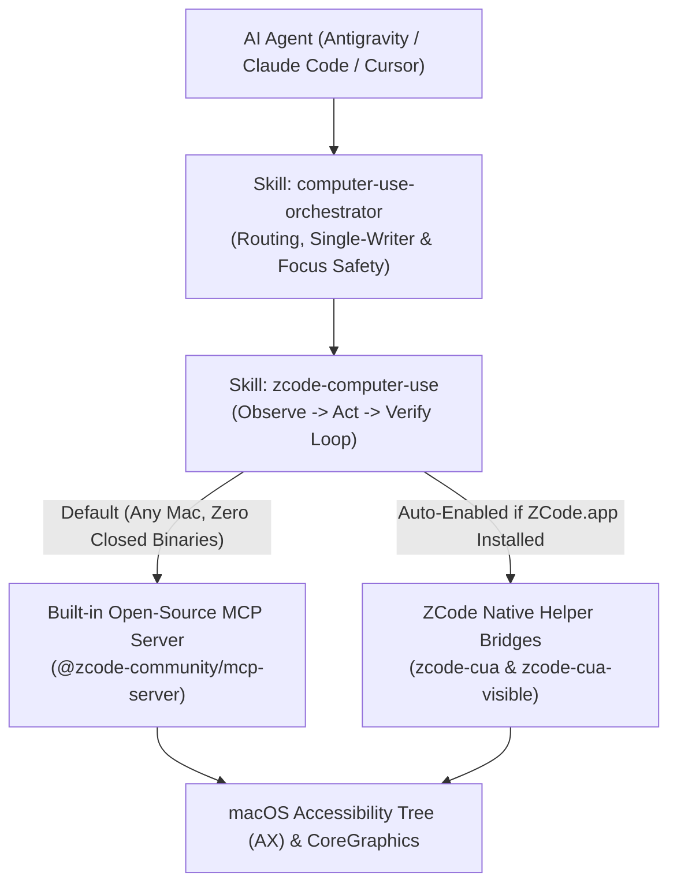

# macOS Computer Use Kit

[](./LICENSE)
[](#requirements)
[](#architecture)

[简体中文文档 (Chinese README)](./README.zh-CN.md)

Turnkey **Computer Use Skills + Open-Source Accessibility MCP Server** for AI coding agents on macOS (**Antigravity**, **Claude Code**, **Cursor**, and any MCP-compatible host).

Clone once, run `./install.sh`, grant macOS Accessibility permission, and your agent can immediately inspect and operate native macOS desktop apps **in the background without stealing your mouse cursor or window focus**.

---

## What You Get Out of the Box

1. **Two Battle-Tested Agent Skills (`skills/`)**
   - **`computer-use-orchestrator`**: High-level routing discipline—semantic Accessibility (AX) first, background zero-focus execution, single-writer window ownership, safe background window closing (`AXCloseButton`), and fail-closed recovery.
   - **`zcode-computer-use`**: Concrete execution loop (`Observe → Act → Verify`), GOOD/DEGRADED/FAILED state triage, atomic `return_state="compact"` updates, `NSOpenPanel`/`NSSavePanel` (`⌘⇧G`) handling, destructive action guards, and a zero-dependency read-only verifier (`scripts/rpc_probe.py`).
2. **Self-Contained Open-Source macOS AX MCP Server (`packages/`)**
   - Zero proprietary binaries and zero runtime npm dependencies—powered by a clean-room native Swift `ApplicationServices` + `CoreGraphics` helper (`macos-ax-helper`, compiled locally during `install.sh` / `npm run build`).
   - Deep accessibility tree traversal (up to depth 20 in <100ms, supporting native AppKit/SwiftUI, Electron, Chromium, WebKit, and QtWebEngine), zero-focus background `AXPress`, occlusion-verified coordinate fallback for non-`AXPress` controls, `CGEvent.postToPid` background keys, and automatic password-field redaction.
   - Exposes 40+ standardized tools (`list_apps`, `list_windows`, `get_app_state`, `left_click`/`click`, `set_value`, `perform_action`, `open_application`/`launch_app`, `screenshot`, `request_access`, `stop_computer_control`, clipboard tools, and compact/diff context compression).
3. **Optional Legacy ZCode Helper Bridges (`bridges/`)**
   - By default (and on Macs with ZCode >= 3.18.0 where external bridge connections are restricted by `verifyPeer`), `zcode-cua` points directly to the built-in open-source macOS AX MCP server—**no third-party app required**.
   - On legacy ZCode (< 3.18.0) installations, optional `zcode-cua-bridge.mjs` and `zcode-cua-visible-bridge.mjs` remain available while keeping the open-source server registered as `cua-open`.

---

## 1-Minute Quick Start (macOS)

### Prerequisites
- **macOS 13+** (Apple Silicon or Intel)
- **Node.js >= 20** (`node -v`)
- **Python 3.9+** (pre-installed on macOS, used only for the optional read-only `rpc_probe.py` health check)

### Install

```bash
git clone https://github.com/timexingxin/macos-computer-use-kit.git
cd macos-computer-use-kit
./install.sh
```

What `./install.sh` does automatically:
1. Compiles the TypeScript workspace (`pnpm` or `npm`—whichever you have) into a self-contained runtime under `~/.local/share/macos-computer-use-kit/`.
2. Detects your installed AI agent clients (**Antigravity**, **Claude Code**, **Cursor**) and copies `computer-use-orchestrator` and `zcode-computer-use` into their `skills/` directories.
3. Non-destructively merges `zcode-cua` into your MCP config (creating a timestamped `.bak` backup first).
4. Runs `rpc_probe.py --guard` over stdio to verify live MCP handshake, tool manifest registration, subagent safety guard (`SUBAGENT_COMPUTER_USE_UNAVAILABLE`), and clean process teardown.

### Grant macOS Accessibility Permission

Open **System Settings → Privacy & Security → Accessibility** (and **Screen Recording** if you need visual fallback screenshots) and enable the toggle for your host app (e.g., **Antigravity**, **Terminal / iTerm2**, **Cursor**, or **ZCode**).

Restart or reload MCP servers in your agent client, and you are ready to prompt:
> *"Open Calculator in the background, compute 128 * 256 via accessibility controls without moving my mouse, and verify the result."*

---

## Installer Options

```bash
./install.sh                                  # Auto-detect clients & backend mode
./install.sh --client antigravity             # Target Antigravity (~/.gemini/config)
./install.sh --client claude                  # Target Claude Code (~/.claude)
./install.sh --client cursor                  # Target Cursor (~/.cursor)
./install.sh --client all                     # Install to all supported clients
./install.sh --mode open                      # Force pure open-source macOS AX MCP backend
./install.sh --preserve-skills                # Upgrade runtime without overwriting customized SKILL.md files
./install.sh --mode both                      # Legacy ZCode (<3.18) bridges + open-source fallback
./install.sh --dry-run                        # Preview changes without writing files
./install.sh --uninstall                      # Cleanly remove kit skills, runtime & MCP entries
```

---

## Architecture



---

## Verification & Diagnostics

```bash
# Run built-in CLI environment doctor
npm run doctor

# Run read-only MCP handshake & subagent guard probe
npm run probe

# Run full unit, protocol, adversarial & installer E2E test suite
npm test
```

---

## Security & Safety Design

- **Background-First, Focus-Safe**: Semantic AX actions (`click`, `set_value`, `perform_action`) act directly on element references without moving the physical pointer or stealing foreground focus.
- **Zero Fake-Success Policy**: Unsupported operations fail closed with structured error codes (`unsupported_platform`, `stale_handle`, `ambiguous_element`, `permission_denied`).
- **Main-Agent Serialization Guard**: Rejects subagent GUI mutation calls (`SUBAGENT_COMPUTER_USE_UNAVAILABLE`) to prevent concurrent multi-agent desktop race conditions.
- **Emergency Kill Switch**: Calling `stop_computer_control` immediately halts mutating operations on the active MCP session.

---

## License & Disclaimer

Licensed under the [Apache License 2.0](./LICENSE). See [NOTICE](./NOTICE) for attribution and third-party trademark disclosures. No proprietary binaries are bundled in this repository.
