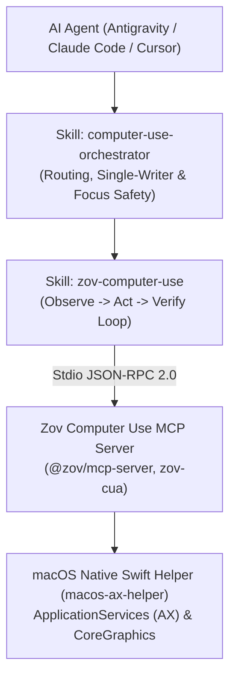

# Zov Computer Use

[](./LICENSE)
[](#prerequisites)
[](#architecture)

[简体中文文档 (Chinese README)](./README.zh-CN.md)

Turnkey **macOS Computer Use Skills + Native Swift Accessibility & CoreGraphics MCP Server** for AI coding agents (**Antigravity**, **Claude Code**, **Cursor**, and any MCP-compatible host).

Clone once, run `./install.sh`, grant macOS Accessibility permission, and your agent can immediately inspect and operate native macOS desktop applications **in the background without stealing your mouse cursor or window focus**.

---

## What You Get Out of the Box

1. **Two Production Agent Skills (`skills/`)**
   - **`computer-use-orchestrator`**: High-level routing discipline—semantic Accessibility (AX) first, background zero-focus execution, single-writer window ownership, safe background window closing (`AXCloseButton`), and fail-closed recovery.
   - **`zov-computer-use`**: Concrete execution loop (`Observe → Act → Verify`), GOOD/DEGRADED/FAILED state triage, single-roundtrip atomic `return_state="compact"` updates, `NSOpenPanel`/`NSSavePanel` (`⌘⇧G`) handling, destructive action guards, and a zero-dependency read-only verifier (`scripts/rpc_probe.py`).
2. **Self-Contained Native macOS AX MCP Server (`packages/`, `zov-cua`)**
   - Zero proprietary binaries and zero runtime npm dependencies—powered by a compiled native Swift `ApplicationServices` + `CoreGraphics` engine (`macos-ax-helper`, compiled locally during `./install.sh` / `npm run build`).
   - Deep accessibility tree traversal (up to depth 20, typical ~100ms capture on responsive apps with an 8s bounded wall-clock budget for hung views; supporting AppKit/SwiftUI, Electron, Chromium, WebKit, and QtWebEngine), zero-focus background `AXPress` with secondary TOCTOU verification, occlusion-verified coordinate fallback, `CGEvent.postToPid` background keys, and full-path password redaction.
   - Exposes **47 standardized tools** (`list_apps`, `list_windows`, `get_app_state`, `left_click`/`click`, `set_value`, `perform_action`, `open_application`/`launch_app`, `screenshot`, `request_access`, `stop_computer_control`, clipboard tools, and compact/diff context compression).

---

## 1-Minute Quick Start (macOS)

### Prerequisites
- **macOS 13+** (Apple Silicon or Intel)
- **Xcode Command Line Tools** (`xcode-select --install` — provides `/usr/bin/swiftc` to compile `macos-ax-helper` and `python3` 3.9+ for the post-install `rpc_probe.py` health check)
- **Node.js >= 20** (`node -v`)

### Install

```bash
git clone https://github.com/timexingxin/zov-computer-use.git
cd zov-computer-use
./install.sh
```

What `./install.sh` does automatically:
1. Compiles the TypeScript workspace and native Swift `macos-ax-helper` into a self-contained runtime under `~/.local/share/zov-computer-use/`.
2. Detects your installed AI agent clients (**Antigravity**, **Claude Code**, **Cursor**) and installs `computer-use-orchestrator` and `zov-computer-use` into their `skills/` directories (creating full directory backups if customized).
3. Atomically and non-destructively merges `zov-cua` into your MCP config (creating a timestamped `.bak` backup first).
4. Runs `rpc_probe.py --guard` over stdio to verify live MCP handshake, 47-tool manifest registration, native macOS `list_apps` execution, subagent safety guard (`SUBAGENT_COMPUTER_USE_UNAVAILABLE`), and clean process teardown.

### Grant macOS Accessibility Permission

Open **System Settings → Privacy & Security → Accessibility** (and **Screen Recording** if you need visual fallback screenshots) and enable the toggle for your host app (e.g., **Antigravity**, **Terminal / iTerm2**, **Cursor**, or **Claude**).

Restart or refresh MCP servers in your agent client, and you are ready to prompt:
> *"Open Calculator in the background, compute 128 * 256 via accessibility controls without moving my mouse, and verify the result."*

---

## Installer Options

```bash
./install.sh                                  # Auto-detect clients & install zov-cua
./install.sh --client antigravity             # Target Antigravity (~/.gemini/config)
./install.sh --client claude                  # Target Claude Code (~/.claude)
./install.sh --client cursor                  # Target Cursor (~/.cursor)
./install.sh --client all                     # Install to all supported clients
./install.sh --preserve-skills                # Upgrade runtime without overwriting customized SKILL.md files
./install.sh --dry-run                        # Preview changes without writing files
./install.sh --uninstall                      # Cleanly remove kit-owned skills, runtime & zov-cua MCP entries
```

---

## Architecture



---

## Verification & Diagnostics

```bash
# Run built-in CLI environment doctor
npm run doctor

# Run read-only MCP handshake & subagent guard probe
npm run probe

# Run full unit, protocol, Swift CLI golden, adversarial & installer E2E test suite
npm test
```

---

## Security & Safety Design

- **Background-First, Focus-Safe**: Semantic AX actions (`click`, `set_value`, `perform_action`) act directly on element references with secondary TOCTOU checks, without moving the physical pointer or stealing foreground focus.
- **Zero Fake-Success Policy**: Runtime schema validation, strict modifier whitelists, and structured error codes (`unsupported_platform`, `stale_handle`, `ambiguous_element`, `window_not_found`, `foreground_required`, `timeout`).
- **Timeout Replay Guard**: Mutating timeouts report `action_sent: true` so agents re-observe rather than replaying partial clicks or keystrokes.
- **Main-Agent Serialization Guard**: Cooperative metadata check (`SUBAGENT_COMPUTER_USE_UNAVAILABLE`) keeps desktop GUI calls serialized on the main agent.
- **Emergency Kill Switch**: Calling `stop_computer_control` immediately halts all subsequent calls on the active MCP session (except `get_capabilities`, `wait`, and `stop_computer_control`) and releases tracked held mouse inputs.

---

## License & Disclaimer

Licensed under the [Apache License 2.0](./LICENSE). See [NOTICE](./NOTICE) for attribution and third-party trademark disclosures. No proprietary binaries are bundled in this repository.
