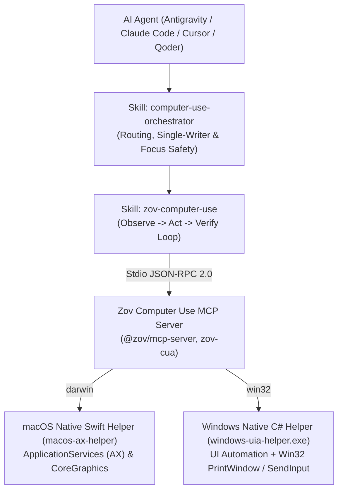

# Zov Computer Use

[](./LICENSE)
[](#quick-start)
[](#architecture)

[简体中文文档 (Chinese README)](./README.zh-CN.md)

Turnkey **Cross-Platform Desktop Computer Use Skills + Dual-Native Accessibility/UIA MCP Server (`zov-cua`)** for AI coding agents (**Antigravity**, **Claude Code**, **Cursor**, **Qoder**, and any MCP-compatible host) on **macOS 13+** and **Windows 10/11**.

Clone once, run `./install.sh` (macOS) or `.\install.ps1` / `install.cmd` (Windows), and your agent can inspect and operate native desktop applications **in the background without stealing your mouse cursor or window focus**.

---

## What You Get Out of the Box

1. **Two Production Agent Skills (`skills/`)**
   - **`computer-use-orchestrator`**: High-level routing discipline—semantic Accessibility / UI Automation first, background zero-focus execution, single-writer window ownership, safe background window closing, and fail-closed recovery.
   - **`zov-computer-use`**: Concrete execution loop (`Observe → Act → Verify`), GOOD/DEGRADED/FAILED state triage, single-roundtrip atomic `return_state="compact"` updates, native macOS (`⌘⇧G`) & Windows Open/Save dialog handling, destructive action guards, and a zero-dependency read-only verifier (`scripts/rpc_probe.py`).
2. **Self-Contained Dual-Native MCP Server (`packages/`, `zov-cua`)**
   - **macOS Native Engine (`macos-ax-helper`)**: Compiled locally via `/usr/bin/swiftc` (`ApplicationServices` + `CoreGraphics`). Deep AX tree capture (~100ms typical), zero-focus background `AXPress` + `AXValue`, Qt6/WebEngine occlusion-verified fallback, and `CGEvent.postToPid` background keys.
   - **Windows Native Engine (`windows-uia-helper.exe`)**: Compiled locally via Windows built-in `.NET Framework 4.x` `csc.exe` (`UIAutomationClient` + Win32 `user32.dll`/`gdi32.dll`/`shcore.dll`, Per-Monitor DPI v2). Zero PowerShell cold-start or shell injection—supports background zero-focus `InvokePattern`, `ValuePattern.SetValue`, `TogglePattern`, `SelectionItemPattern`, offscreen `PrintWindow(PW_RENDERFULLCONTENT)` window screenshots, `WindowFromPoint` occlusion checks, and Unicode `SendInput`.
   - **47 Standardized Tools**: `list_apps`, `list_windows`, `get_app_state`, `left_click`/`click`, `set_value`, `perform_action`, `open_application`/`launch_app`, `screenshot`, `request_access`, `stop_computer_control`, clipboard tools, and compact/diff context compression with automatic password redaction (`[REDACTED_PASSWORD]`).

---

## Quick Start

### macOS (13+)
- **Prerequisites**: Node.js >= 20, Xcode Command Line Tools (`xcode-select --install`)
```bash
git clone https://github.com/timexingxin/zov-computer-use.git
cd zov-computer-use
./install.sh
```
Then enable **System Settings → Privacy & Security → Accessibility** (and **Screen Recording** for screenshots) for your host app.

### Windows (10 / 11)
- **Prerequisites**: Node.js >= 20, Python 3.9+ (optional, for post-install `rpc_probe.py`; `.NET Framework 4.x csc.exe` is pre-installed in `C:\Windows\Microsoft.NET\Framework64\v4.0.30319`)
```powershell
git clone https://github.com/timexingxin/zov-computer-use.git
cd zov-computer-use
.\install.ps1
```
*(Or run `install.cmd` from `cmd.exe`.)* Restart your agent client to load `zov-cua`.

---

## Installer Options

```bash
# macOS: ./install.sh [options]   |   Windows: .\install.ps1 [options]
--client <auto|antigravity|claude|cursor|qoder|all>   # Target specific agent client(s)
--preserve-skills                                     # Upgrade runtime without overwriting customized SKILL.md
--dry-run                                             # Preview changes without writing files
--skip-probe                                          # Skip Python post-install stdio probe
--uninstall                                           # Cleanly remove kit-owned skills, runtime & zov-cua entries
```

---

## Architecture



---

## Verification & Diagnostics

```bash
# Run built-in CLI environment doctor
npm run doctor

# Run full unit, protocol, native golden, adversarial & installer E2E test suite
npm test
```

---

## Security & Safety Design

- **Background-First, Focus-Safe**: Semantic AX/UIA actions (`click`, `set_value`, `perform_action`) act directly on element patterns with secondary TOCTOU checks, without moving the physical pointer or stealing foreground focus.
- **Zero Shell / Zero Injection**: Both `macos-ax-helper` and `windows-uia-helper.exe` are invoked strictly via `child_process.spawn(exe, argvArray)` with zero PowerShell or shell string interpolation.
- **Zero Fake-Success Policy**: Runtime schema validation, strict modifier whitelists, and structured error codes (`unsupported_platform`, `stale_handle`, `ambiguous_element`, `window_not_found`, `foreground_required`, `permission_denied`, `timeout`).
- **Timeout Replay Guard**: Mutating timeouts report `action_sent: true` so agents re-observe rather than replaying partial clicks or keystrokes.
- **Main-Agent Serialization & Kill Switch**: Cooperative subagent guard (`SUBAGENT_COMPUTER_USE_UNAVAILABLE`) and session-level `stop_computer_control` releasing tracked held inputs.

---

## License & Disclaimer

Licensed under the [Apache License 2.0](./LICENSE). See [NOTICE](./NOTICE) for attribution and third-party trademark disclosures. No proprietary binaries are bundled in this repository.
