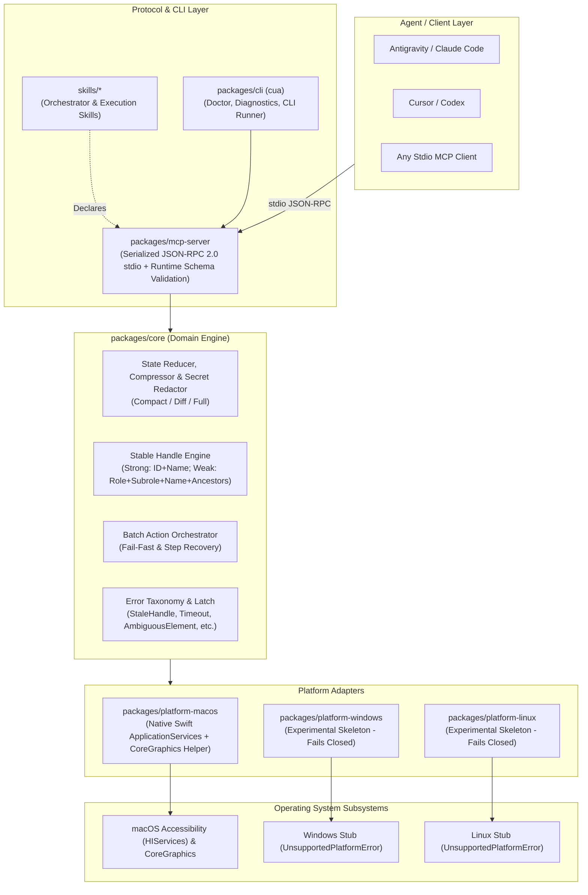

# System Architecture: macos-computer-use-kit

`macos-computer-use-kit` is a modular, local-first Computer Use runtime engineered for AI agents, featuring first-class Model Context Protocol (MCP) stdio execution and turnkey skill installation.

---

## 1. High-Level Architecture Overview

---

## 2. Core Subsystems

### A. Core Engine (`packages/core`)
- **Stable Element Handles**: UI element indices (`index: 12`) fluctuate across dynamic repaints. Strong handles (`h_str_<role>_<hash>`) hash `window_id + role + identifier + name`; weak handles (`h_wk_<role>_<hash>`) hash `window_id + role + subrole + name + ancestor_role_chain` (deliberately omitting volatile `ax_path` sibling indices so handles survive sibling insertions while flagging collisions as `ambiguous: true`).
- **State Compression & Secret Redaction**: Raw accessibility trees are sanitized on every observation and `return_state` path (`compact`, `diff`, and `full`) before serialization. `computeStateDiff` uses occurrence-indexed keys (`${handle}#${occurrence}`) so duplicate weak handles never mask deletions.
- **Error Taxonomy & Delivery Truthfulness**: Distinct error classes (`PermissionDeniedError`, `ElementNotFoundError`, `StaleHandleError`, `WindowNotFoundError`, `InvalidArgumentError`, `TimeoutError`) expose `recoverable` and `action_sent` flags; mutating helper timeouts report `action_sent: true` to prevent blind replay of partially delivered GUI events.

### B. MCP Server (`packages/mcp-server`)
- Pure, serialized newline-delimited JSON-RPC 2.0 implementation over `stdio` (zero network ports, 2 MiB line framing cap, whitelisted MCP protocol version negotiation).
- Exposes **47 standardized Computer Use tools** (39 primary tools + 8 aliases) with runtime schema validation (`required`, `enum`, `Number.isFinite`, integer/range bounds) and bounded 64-entry FIFO state caching.
- Maintains strict stdio stream cleanliness: `stdout` carries exclusively JSON-RPC envelopes; diagnostics write to `stderr`.

### C. Platform Adapters
- **macOS (`packages/platform-macos`)**: Compiled native Swift `ApplicationServices` + `CoreGraphics` + `AppKit` helper (`macos-ax-helper`), weak `dlsym` lookup for `_AXUIElementGetWindow`, bounded 8s `inspect` deadline, background zero-focus `AXPress` with secondary TOCTOU role + identifier/name verification, occlusion-verified coordinate fallback (with AX hit-test disambiguation for click-through overlays), `postToPid` background keyboard delivery, and Retina `scale_factor` metadata on `screencapture`.
- **Windows (`packages/platform-windows`)**: Pure fail-closed skeleton throwing `UnsupportedPlatformError` (zero PowerShell command execution, zero fake-success).
- **Linux (`packages/platform-linux`)**: Pure fail-closed skeleton throwing `UnsupportedPlatformError` (zero fake-success).
