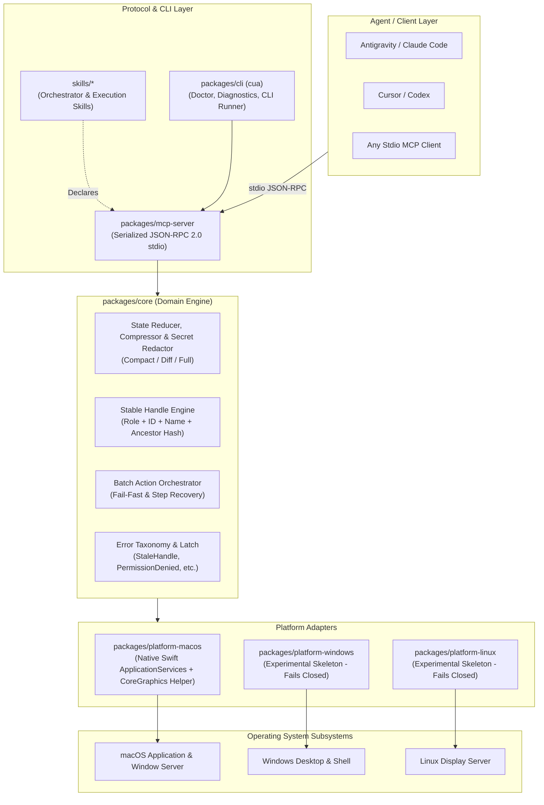

# System Architecture: macos-computer-use-kit

`macos-computer-use-kit` is a modular, local-first Computer Use runtime engineered for AI agents, featuring first-class Model Context Protocol (MCP) stdio execution and turnkey skill installation.

---

## 1. High-Level Architecture Overview

---

## 2. Core Subsystems

### A. Core Engine (`packages/core`)
- **Stable Element Handles**: UI element indices (`index: 12`) fluctuate across dynamic app repaints. The stable handle engine computes content-addressable identifiers (`h_<role>_<hash>`) based on `window_id + role + name + accessibility_path`, ensuring commands target the correct control even after UI updates.
- **State Compression & Token Efficiency**: Raw accessibility trees from complex applications can consume tens of thousands of tokens. The reducer provides `compact` mode (default, pruning non-interactive containers) and `diff` mode (only modified nodes since the last `state_id`).
- **Error Taxonomy**: Distinct error classes (`PermissionDeniedError`, `ElementNotFoundError`, `StaleHandleError`, `WindowNotFoundError`, `TimeoutError`) enable intelligent agent self-recovery rather than generic failures.

### B. MCP Server (`packages/mcp-server`)
- Pure, serialized newline-delimited JSON-RPC 2.0 implementation over `stdio` (zero network ports).
- Exposes 45+ standardized Computer Use tools and legacy aliases with schema validation and bounded FIFO state caching.
- Maintains strict stdio stream cleanliness: stdout is reserved solely for JSON-RPC messages; all diagnostic traces route to stderr.

### C. Platform Adapters
- **macOS (`packages/platform-macos`)**: Compiled native Swift `ApplicationServices` + `CoreGraphics` + `AppKit` helper (`macos-ax-helper`), up-to-depth-20 AX tree capture, background zero-focus `AXPress`, occlusion-verified coordinate fallback, `postToPid` background keyboard delivery, and native `screencapture` integration.
- **Windows (`packages/platform-windows`)**: Experimental skeleton throwing `UnsupportedPlatformError` (Zero Fake-Success).
- **Linux (`packages/platform-linux`)**: Experimental skeleton throwing `UnsupportedPlatformError` (Zero Fake-Success).
