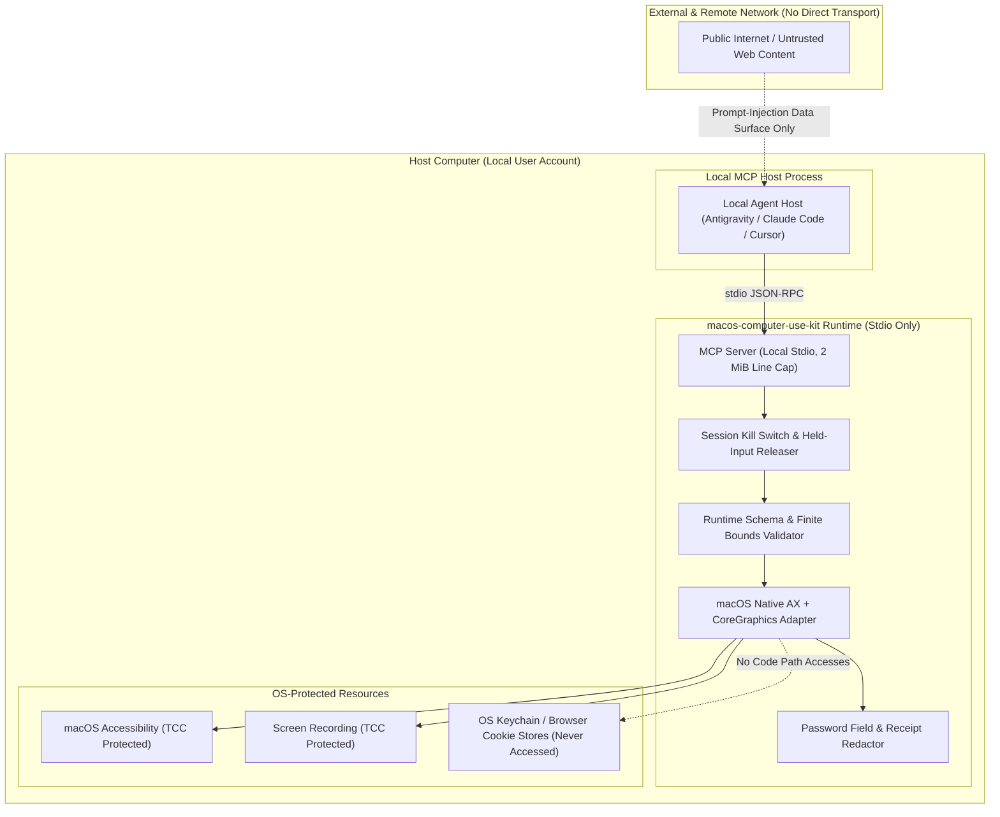

# Security Model & Trust Boundaries

`macos-computer-use-kit` exercises privileged local OS capabilities (UI tree inspection, synthetic keyboard/mouse events, screen capture). This document states the exact runtime boundaries enforced in code—without overclaiming guarantees that only the host OS or agent client can enforce.

---

## 1. Trust Boundaries Diagram

---

## 2. Enforced Security Properties & Known Boundaries

### 1. Local-Only Stdio Transport (No Network Listener)
- `@zcode-community/mcp-server` communicates strictly over local `stdin`/`stdout` with zero TCP/HTTP/WebSocket listeners and no built-in remote authentication layer. Never expose its `stdio` pipes directly over an unauthenticated network socket.
-(Note: per-session token files apply only to the optional legacy ZCode Unix-domain socket bridge in `bridges/`.)

### 2. Zero Keychain or Browser Storage Harvesting
- The codebase contains zero routines that read macOS Keychain databases, browser cookie SQLite stores, or saved credential files.

### 3. Password Redaction & Receipt Hygiene (and Detection Boundary)
- Every state returned by `get_app_state` (`compact`, `diff`, `full`) and every post-action `return_state` refresh (`click`/`left_click`, `type`/`type_text`, `key`/`press_key`, `set_value`) passes through `redactElementSecrets`.
- Fields with `role`/`subrole` `securetextfield` **or** editable fields (`textfield`, `textarea`, `combobox`, `searchfield`) whose `name`, `description`, or `identifier` matches password keywords (`password`, `passcode`, `passwd`, `pin code`, `密码`, `口令`) have non-empty values replaced with `[REDACTED_PASSWORD]`.
- `set_value` and `write_clipboard` receipts report character lengths rather than echoing plaintext values.
- **Known Boundary**: Custom web/canvas inputs exposed as generic `textfield` without `securetextfield` subrole or password-related accessibility labels cannot be distinguished from ordinary text inputs; arbitrary non-password secrets visible on screen (e.g., API keys in plain terminal windows or screenshots) are **not** automatically scrubbed.

### 4. Timeout Replay Prevention (`action_sent: true`)
- Multi-step OS input helpers (`click-coord`, `key`, `type-unicode`, `act-element`, `pointer-op`, `window-op`) run in isolated process groups. If a mutating helper exceeds its deadline and is terminated, `MacOSAdapter` throws `TimeoutError` with `action_sent: true` so agents re-observe rather than blindly replaying partially delivered clicks or keystrokes.

### 5. Session Kill Switch (`stop_computer_control`)
- Invoking `stop_computer_control` latches `isControlHalted = true` for the lifetime of the MCP process: **all** subsequent tool calls (both mutating and read-only observation tools, except `get_capabilities`, `wait`, and `stop_computer_control`) fail closed, active helper process groups receive `SIGTERM`, temporary screenshot files are unlinked, and compensating `mouse_up` events are dispatched for any mouse buttons recorded via `mouse_down`.
- **Known Boundary**: OS input events already posted to `WindowServer` prior to `stop_computer_control` cannot be retroactively revoked.

### 6. Cooperative Subagent Guard (`_meta`)
- When a host client attaches `_meta["com.zcode/request-context"].runtime_scope === "subagent"`, `handleCallTool` refuses execution with `SUBAGENT_COMPUTER_USE_UNAVAILABLE`. Because `_meta` is supplied by the MCP client over local `stdio`, this is a cooperative serialization guard against multi-agent desktop races—not a cryptographic privilege boundary against a compromised host process.

### 7. Zero Telemetry
- `macos-computer-use-kit` makes zero outbound network requests, analytics pings, or update checks.
